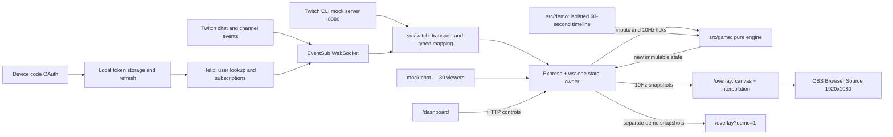

# Siege of the Stream

Siege of the Stream turns Twitch chat into an army of pixel knights fighting a three-phase boss alongside the streamer, directly inside an OBS overlay. Built for the Codex × TwitchCon Hackathon, it makes follows, subscriptions, cheers, and raids part of the battle.

## Gameplay GIF

> **GIF placeholder:** Add a gameplay recording here before submission.
> Record `/overlay?demo=1` to capture the 60-second showcase, then replace this
> block with an embedded GIF (for example, `docs/gameplay.gif`).

## Features

- Chat-controlled knights with Twitch colours, named companies, shared cooldowns,
  defense, healing, and revives.
- Three bosses, three combat phases, and rage attacks with two-second warnings.
- Follows raise a shield dome; subscriptions summon golden champions; bits launch
  fireballs; raids send up to 50 reinforcements marching into battle.
- Procedural pixel art: castle courtyard, dragon silhouette, banners, particles,
  floating damage, impact shake, and a four-event ticker. No external image assets.
- Transparent 1920×1080 OBS canvas with cached sprites and capped effects,
  designed for 60fps and 200+ knights.
- Streamer dashboard for boss selection, round duration, start/stop, and rage;
  a 15-second MVP card ranks damage, healing, and blocks.
- Live Twitch integration, CLI mock events, 30-viewer mock chat, and an isolated
  one-minute demo that needs no Twitch account.

## Quick start: live Twitch

Requires **Node.js 20.19+ or 22.12+** and npm. Run OBS and the server on the same
machine; the server binds to loopback only.

1. [Register a Twitch application](https://dev.twitch.tv/docs/authentication/register-app/)
   in the [developer console](https://dev.twitch.tv/console/apps). Your Twitch
   account needs a verified email and two-factor authentication. Choose a name
   and category, use `http://localhost:3000` if the registration form requires an
   OAuth redirect URL, and set **Client Type: Public**. Copy the Client ID.
   This project uses device codes, so it does not use a redirect callback or
   a client secret.
2. From a fresh checkout, install dependencies and create your local config:

   ```sh
   npm install
   cp .env.example .env
   ```

   For an existing checkout, keep your current `.env` rather than overwriting it.
   Set these values in your local file:

   ```dotenv
   TWITCH_CLIENT_ID=your_public_client_id
   TWITCH_BROADCASTER_LOGIN=your_channel_login
   MOCK_MODE=false
   PORT=3000
   ```

3. Start the app once:

   ```sh
   npm run dev
   ```

   If it is already running on port 3000, use that instance. Configuration changes
   take effect on a later restart that you control.

4. Open **http://localhost:3000/dashboard**. Follow the verification URL and enter
   the device code shown there or in the terminal. Authorize **as the configured
   broadcaster** and wait for the EventSub subscriptions to show as enabled.
5. In OBS, add a **Browser Source** pointing to
   **http://localhost:3000/overlay**, with width **1920**, height **1080**, and
   custom FPS **60**. Keep the source active for continuous rendering.
6. Pick a boss and round length on the dashboard, start a round, then type
   `!join` and `!attack` in the channel's Twitch chat.

Everything outside the courtyard strip and game UI is transparent. Browser
clients reconnect automatically and receive the current authoritative state.
For a Twitch-free judging preview, follow [mock mode](#mock-mode-with-the-twitch-cli)
or open [the scripted demo](#one-minute-demo) on an already running instance.

For a compiled run, use `npm run build` then `npm start` instead of the dev
command. The `public/` directory must stay beside `dist/`. Game state is in
memory and resets when the server restarts.

## Chat commands

| Input     | Effect                                                                                                |
| --------- | ----------------------------------------------------------------------------------------------------- |
| `!join`   | Spawn one named knight per viewer; first action is immediately available                              |
| `!attack` | Deal 25 boss damage                                                                                   |
| `!defend` | Block incoming attacks for 5 seconds                                                                  |
| `!heal`   | Revive yourself if knocked out; otherwise restore 30 HP to the most injured ally, including KO allies |

## Twitch event effects

| Event                | Effect                                                             |
| -------------------- | ------------------------------------------------------------------ |
| Follow               | Shield the entire army for 10 seconds; another follow refreshes it |
| Subscription or gift | Summon a 200-HP champion attacking for 40 every 3 seconds          |
| Cheer                | Fireball dealing 1 damage per bit                                  |
| Raid                 | Spawn up to 50 reinforcements attacking for 10 every 3 seconds     |

Attack, defend, and heal share a **3-second per-viewer cooldown**. Knocked-out
knights can return with `!heal`. Bosses strike every 5 seconds for 10/20/30 HP
according to phase. At two-thirds and one-third HP they enter phases two and
three. Phase three unleashes repeating rage attacks: **two seconds to defend**
before every unprotected knight in the marked area is knocked out. The
dashboard can trigger rage in any phase. A shield wall also blocks rage.

Boss death is victory; timer expiry is defeat. Stopping a round shows results
too. MVP results stay visible for **15 seconds** before another round can start.
Scores combine damage, actual healing, and 25 points per blocked hit. Champions
and reinforcements also appear in the rankings.

All knights are drawn: 24 get large foreground sprites and nameplates, with the
rest in compact reserve ranks. Named companies rotate every six seconds. Names
are capped at 12 characters and retain Twitch chat colours on contrasting plates.
Rendering uses `requestAnimationFrame`, cached procedural sprites and scenery,
and capped pools (360 particles, 40 numbers, 6 fireballs). Canvas `data-fps`,
`data-draw-ms`, `data-knights`, and `data-particles` expose performance diagnostics.

## One-minute demo

Open **http://localhost:3000/overlay?demo=1** as a browser or OBS source. It starts
immediately and loops every 60 seconds: 45 seconds of battle, then the full
15-second MVP card. It uses the real engine on an isolated server-side timeline
per connection, works without Twitch, and never changes the live/dashboard round.
Refresh the source to restart the sequence for recording.

The script grows to 252 knights, shows a follow at 4s, subscription at 7s, gift at
10s, 500-bit fireball at 14s, raid at 18s, rage at 22s, knockouts at 24s and revives
at 25s. Further cheers and attacks advance all three boss phases; the final
fireball wins at 45s. Game visuals include shield domes, champion banners, raid
marches, floating damage, impact shake and red attack zones.

## Configuration

| Variable                     | Default / use                                  |
| ---------------------------- | ---------------------------------------------- |
| `PORT`                       | `3000`                                         |
| `MOCK_MODE`                  | `true`; `false` disables mock ingestion routes |
| `TWITCH_CLIENT_ID`           | Registered Twitch public-client application ID |
| `TWITCH_BROADCASTER_LOGIN`   | Broadcaster account that authorizes this app   |
| `TWITCH_MOCK_BROADCASTER_ID` | `1234`; channel ID for local CLI events        |

## How it connects to Twitch

The app uses a **public-client OAuth Device Code Grant**, **Helix**, and an
**EventSub WebSocket** in the same Node.js process:

1. `POST https://id.twitch.tv/oauth2/device` requests a code and verification URL.
   The dashboard and terminal display them while the server polls
   `POST https://id.twitch.tv/oauth2/token` for authorization.
2. Helix `GET /users?login=...` resolves `TWITCH_BROADCASTER_LOGIN` to a user ID.
3. The server connects to `wss://eventsub.wss.twitch.tv/ws`. On `session_welcome`,
   it calls Helix `POST /eventsub/subscriptions` for `channel.chat.message` v1,
   `channel.follow` v2, `channel.subscribe` v1, `channel.subscription.gift` v1,
   `channel.cheer` v1, and `channel.raid` v1 (incoming raids use
   `to_broadcaster_user_id`).
4. Notifications are validated, deduplicated, and mapped to typed game inputs.
   The pure engine updates the battle; local WebSocket snapshots feed the canvas.

Keepalive deadlines detect dead connections. Fresh sessions resubscribe with
backoff; Twitch-directed reconnects establish the new socket before closing the
old one and preserve subscriptions. Revocations are visible on the dashboard.

The device flow requests `user:read:chat`, `moderator:read:followers`,
`channel:read:subscriptions`, and `bits:read`. No client secret is used. Tokens
are stored atomically in `.tokens.json` with owner-only permissions, validated at
startup and hourly, and refreshed before expiry or after a Helix 401. `.env`,
`.tokens.json`, and temporary token files are gitignored. Never commit them.
Expired/denied device codes and revoked authorization can be retried from the
dashboard. Tokens and device secrets never appear in dashboard API responses.

Incoming chat must be exactly `!join`, `!attack`, `!defend`, or `!heal`, ignoring
case and outer whitespace. Duplicate EventSub message IDs are suppressed, and
messages from other channels/shared-chat sources are ignored. Gift bundles
summon one champion per gift notification; accompanying gifted subscribe events
are ignored to avoid counting the same gift twice. Each event logs its mapped
effect or why it was ignored.

## Mock mode with the Twitch CLI

Install the [official Twitch CLI](https://dev.twitch.tv/docs/cli/) and use
`MOCK_MODE=true` with `TWITCH_MOCK_BROADCASTER_ID=1234` in a fresh local `.env`.
No Twitch app or authorization is required. On a running instance, keep its
existing configuration; these event commands require that it already be in mock
mode. `/overlay?demo=1` works in either mode.

Start the CLI mock server in one terminal (skip if already running):

```sh
twitch event websocket start-server --require-subscription
```

Start the app in a second terminal **only if it is not already running**:

```sh
npm run dev
```

Once the dashboard shows the mock connection, run this in another terminal:

```sh
npm run mock:chat
```

`mock:chat` joins 30 synthetic viewers, starts a round if idle, and sends random
commands for up to 60 seconds (or until the round ends). Override with
`MOCK_CHAT_SECONDS=120 npm run mock:chat`. It refuses live mode and sends only to
the localhost game server. Synthetic chat envelopes use the same parser, mapper,
deduplication, and game dispatch as incoming EventSub notifications.

The app connects to `ws://127.0.0.1:8080/ws`, creating subscriptions at
`http://127.0.0.1:8080/eventsub/subscriptions`. No OAuth or live credentials are
used in mock mode. Start a round on the dashboard, then trigger events:

```sh
twitch event trigger channel.follow --transport=websocket --to-user 1234 --from-user 1234 --version 2 --no-config
twitch event trigger channel.subscribe --transport=websocket --to-user 1234 --from-user 5678 --no-config
twitch event trigger channel.subscription.gift --transport=websocket --to-user 1234 --from-user 5678 --cost 1 --no-config
twitch event trigger channel.cheer --transport=websocket --to-user 1234 --from-user 5678 --cost 500 --no-config
twitch event trigger channel.raid --transport=websocket --to-user 1234 --from-user 5678 --no-config
twitch event websocket reconnect
```

The CLI can randomly mark a generated `channel.subscribe` as `is_gift=true`;
that notification is intentionally ignored to avoid duplicate champions. Retry
until it produces a non-gift subscription, or use the gift command above for a
reliable champion trigger.

For CLI follows, `--from-user 1234` also supplies the moderator condition used by
`--require-subscription`. CLI-generated raid sizes are random; the engine still
caps reinforcements at 50. Change IDs if you configure a different mock channel.

**CLI 1.1.24 limitation:** it supports the five non-chat event types above but
rejects `channel.chat.message` subscriptions. The dashboard reports this as a
partial connection; `npm run mock:chat` provides the chat demo independently.
Live Twitch uses the real chat subscription.

Protocol references: [device flow](https://dev.twitch.tv/docs/authentication/getting-tokens-oauth/#device-code-grant-flow),
[EventSub WebSockets](https://dev.twitch.tv/docs/eventsub/handling-websocket-events/),
[CLI mock server](https://dev.twitch.tv/docs/cli/websocket-event-command/).

## Architecture



All server components run in one Node.js process. The engine has no network,
filesystem, timers, or random calls; it receives elapsed simulation time and
returns new state. Browser animation runs independently at display refresh rate.

```text
siege-of-the-stream/
├── public/                 # Canvas overlay, procedural art/effects, dashboard
├── src/
│   ├── game/               # Pure state, commands, combat, fixed ticks
│   ├── twitch/             # Device auth, token store, Helix, EventSub, mapping
│   ├── app.ts              # HTTP controls and WebSocket state owner
│   ├── demo.ts             # Scripted battle isolated from the live round
│   ├── server.ts           # Config and localhost startup
│   └── validation.ts       # HTTP input validation
├── scripts/                # Mock chat and JavaScript syntax checks
├── tests/
│   └── fixtures/eventsub/  # Synthetic and locally generated CLI samples
├── .env.example            # Configuration template, no credentials
├── .gitignore              # Secrets, local data, dependencies, build output
├── AGENTS.md               # Architecture and conventions for future Codex work
├── LICENSE                 # MIT
├── package.json            # Development and verification commands
├── package-lock.json       # Dependency lockfile
├── tsconfig.json
├── vitest.config.ts
└── README.md
```

## How this was built with Codex

This project was built iteratively in this Codex conversation:

1. **Foundation prompt:** scaffold Node.js 20 + TypeScript, Express, `ws`, a pure
   game engine ticking at 10Hz, overlay/dashboard pages, `.env.example`, and
   `AGENTS.md`. Test joining, cooldowns, combat, event effects, phases, and MVPs.
2. **Local setup and first checkpoint:** configure the broadcaster locally,
   exclude `.env` from Git, and commit the foundation as
   `Prompt 1: game engine, server, overlay, dashboard, tests`.
3. **Twitch connection prompt:** implement public-client device authorization,
   token refresh, Helix lookup, all six EventSub subscriptions, reconnect handling,
   typed event mapping, CLI mock support, and 30-viewer simulated chat. Test with
   synthetic envelopes and recorded local CLI payloads.
4. **Make it fun to watch:** build procedural pixel art, readable nameplates,
   event feedback, two-second rage warnings, KO/revive animation, and MVP results.
   Add the isolated 60-second demo; exercise mock chat and CLI events and inspect
   the rendered overlay, fixing layout and effect issues found along the way.
5. **Judging preparation:** document setup and architecture, add the MIT license,
   tighten local-data ignore rules, scan Git history and submission files for
   secrets, and rerun formatting/syntax, type, and test checks.

Codex handled implementation, regression tests, documentation, and browser-based
visual inspection. Broadcaster consent and the final OBS/video capture remain
human steps. Live Twitch authorization and actual OBS 60fps are not yet verified;
local mock events and the scripted showcase have been exercised. The inspection
browser capped changing canvases near 30fps, including a minimal control canvas,
so that environment could not establish the OBS frame rate.

## Verify

```sh
npm run lint
npm run typecheck
npm test
npm run test:coverage
npm run build
```

`lint` checks Prettier formatting and JavaScript syntax without executing the
browser or mock-chat scripts; `typecheck` checks TypeScript semantics. Checks do
not require the production server. Integration tests start their own servers on
OS-assigned temporary ports and do not contact the instance on port 3000.

Engine tests use deterministic simulation time. Integration tests bind temporary
localhost ports to test controls and the real WebSocket stream. Coverage applies
to `src/game/` and enforces 80% lines, statements, branches, and functions.
See [AGENTS.md](AGENTS.md) for architecture and development conventions.

## Local data and license

`.env` variants (except `.env.example`), `.tokens.json` and its temporary files,
`data/`, `captures/`, `logs/`, log files, and local database files are gitignored.
Keep runtime captures in those directories. Sanitized test fixtures remain
versioned so tests are reproducible; do not replace them with private viewer data
or credentials. Access/refresh tokens never enter browser state.

Licensed under the [MIT License](LICENSE).
